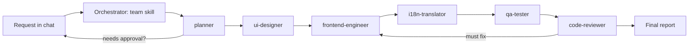

# Frosty Delights: demo script and project guide

Say the words in quotes. Everything else is a note for you. Run `npm run build` then `npm run start -- -p 3100` before you start, and open http://localhost:3100 in a fresh tab. Run your `/team` example once beforehand so you know how it behaves.

## 1. The pitch (30 seconds)

"Frosty Delights is a premium ice cream shop website with a full ordering journey: flavors, build-your-own, cart and checkout, live order tracking, rewards, subscriptions, five languages and dark mode. It is built with Next.js and TypeScript, and every change to it is handled by a team of specialized AI agents inside VS Code: a planner, a designer, an engineer, a translator, a tester and a reviewer. I wanted to show both a polished product and a repeatable, safe way to build and change it with AI."

## 2. What exists today (facts you can state)

- Next.js 16 App Router, React 19, TypeScript strict, Tailwind, zod, react-hook-form, Jest and Testing Library.
- 12 route folders (home, flavors, build, menu, cakes-sundaes, checkout, orders, rewards, plans, subscription, locations, contact, about).
- 108 passing tests in 18 suites. Type check, lint and production build pass.
- Five languages (English, Spanish, Hindi, French, German), and a test that fails if any language is missing a key, a placeholder or a plural form.
- Light and dark mode, responsive from 375px to desktop, prices in rupees.
- Personalized picks, favorites, promo codes, a "buy 2, get 1 free" deal, rewards tiers, a subscription you can skip, pause, resume, cancel or switch.
- Six development agents, `CLAUDE.md`, `MEMORY.md` and two skills in the project.

Be upfront about this: all data is demo data stored in the browser or in `src/data`. There is no backend, no real payments and no real accounts.

## 3. Live demo flow (about 8 minutes)

### A. The product (3 minutes)

1. **Home.** "Hero, popular flavors, and a row called Picked for you. It starts with popular flavors and becomes personal once I favorite something or order."
2. **Flavors.** Search "mango", filter dairy-free, open Details (allergens and calories), favorite one, add to cart. "Every third scoop is free, and the cart shows the saving."
3. **Build Your Own.** Pick a waffle cone, two scoops, a topping. "The preview updates live and the price is calculated in code, not typed in."
4. **Cart and promo.** Apply `FROSTY10`. Then try `SWEET100` with a small cart: "It tells me how much more I need to spend."
5. **Checkout.** Place an order for pickup. Open **My orders**: "The order moves through stages in real time. This is a demo timeline of seconds, not minutes."
6. **Rewards and subscription.** "Points come from orders. I can redeem a code. A subscription lets me skip, pause, switch plan or cancel, and every action updates the next delivery date."
7. **Language and theme.** Switch to Hindi, then dark mode. "The whole site is translated, including dates and currency format."

### B. The agent team (4 minutes)

Open the `frosty-delights` folder in VS Code and show these files in the explorer:

- `CLAUDE.md`: "The project's rules and the team roster. It tells the AI how to behave, what to ask before doing, and what 'done' means."
- `MEMORY.md`: "Lessons learned so the same mistake isn't repeated. For example, a real browser test caught a bug that unit tests missed, and that is now a rule."
- `.claude/agents/`: "Six agents, one file each. Each has a name, a description of when to use it, the tools it is allowed to use, and its instructions."
- `.claude/skills/team/SKILL.md`: "The orchestrator's playbook: which agents run for which kind of request, in what order, and how failures loop back."
- `.claude/skills/project-conventions/SKILL.md`: "The technical rulebook: stack, folders, language rules, lint pitfalls and commands."

Then type one request in chat. A safe example:

```
/team add a "Clear cart" button to the cart drawer, with a confirmation, in all languages
```

Narrate while it runs:

1. "The **planner** reads the code and writes a small plan. It flags anything risky, like new packages or deleting files, and asks me before going on."
2. "The **ui-designer** specifies the button, the confirmation, the empty state, phone and dark-mode behavior."
3. "The **frontend-engineer** writes the code with the smallest possible change."
4. "The **i18n-translator** adds the text in the other four languages and runs the translation check."
5. "The **qa-tester** writes tests, runs type check, lint, tests and build, then opens the app in a browser at phone, tablet and desktop widths."
6. "The **code-reviewer** looks for bugs, accessibility and security problems and lists must-fix items. Those go back to the engineer."
7. Show the final report: "What changed, what each agent found, what was run, and what was not verified."

Point to the control: "Read-only agents can run at the same time. Agents that edit files run one at a time so they never overwrite each other. Risky actions need my approval."

### C. Engineering quality (1 minute)

Run `npm run typecheck`, `npm run lint` and `npx jest`. "108 tests. The language test fails if I add English text and forget another language."

## 4. How the agent system works (explain in plain words)

| Piece | What it is | Why it matters |
| --- | --- | --- |
| `CLAUDE.md` | Standing instructions the AI reads first | Keeps behavior consistent and safe |
| `MEMORY.md` | Short list of lessons from past work | The team improves instead of repeating mistakes |
| Agent files | Role, allowed tools, instructions | Specialization: each agent does one job well |
| `team` skill | The orchestrator's workflow | Picks the right agents and handles failure loops |
| `project-conventions` skill | App-specific technical rules | Agents write code that matches the app |



Reuse: "Every new app I build gets the same team copied in from a template, so the workflow travels with the project."

## 5. Honest limits and likely questions

- **"Is this a real multi-agent system?"** "It is a multi-agent development workflow: specialized agents with roles, tools, hand-offs and a feedback loop, run by VS Code's AI. It is not a production service for end users. The next step, below, is to build one."
- **"Is any of the shop real?"** "No. Data is demo data, payments and accounts are simulated, and the assistant I prototyped earlier used keyword rules, not an AI model, and was removed from the app."
- **"How do you trust AI-written code?"** "Tests, type checking, lint, a build, a browser check and a separate reviewer agent, plus approval for risky actions."
- **"Why separate agents instead of one prompt?"** "Smaller focused instructions are easier to improve, can run in parallel when they only read, and the reviewer isn't grading its own work."

## 6. What is missing for real-world, production use

### The shop itself

| Gap | Use |
| --- | --- |
| Real data and accounts | PostgreSQL with Prisma or Drizzle; Auth.js or Clerk for login |
| Real payments | Stripe Checkout and webhooks |
| Real order flow | Server-side order and inventory logic; a kitchen dashboard |
| Notifications | Resend or SendGrid for email; Twilio for SMS |
| Delivery and maps | Google Maps or Mapbox for addresses and tracking |
| Content | A headless CMS (Sanity or Contentful) for flavors and menu |
| Quality | Playwright end-to-end tests, Lighthouse and axe accessibility audits |
| Operations | Vercel hosting with preview deploys, GitHub Actions CI, Sentry for errors, analytics, feature flags |
| Security and privacy | OWASP review, rate limiting, input validation on the server, cookie and privacy policy |

### Shopper-facing multi-agent assistant (the real showcase)

| Gap | Use |
| --- | --- |
| A real model | Claude or OpenAI via their APIs, key kept on the server |
| Agent framework | LangGraph, the Vercel AI SDK or the Claude Agent SDK for supervisor and specialist agents |
| Real tools | Typed tool calls to the real order, subscription, rewards and store APIs; MCP servers to expose them |
| Knowledge | Retrieval from the catalog and FAQs with pgvector or Pinecone |
| Memory | Per-user preferences and conversation history in the database |
| Safety | Human confirmation for changes, prompt-injection defenses, output validation with zod, per-user rate limits and cost caps |
| Evals | A test set of questions with expected routing and answers, run in CI (Promptfoo or LangSmith evals) |
| Observability | Tracing of every agent step and tool call (Langfuse, LangSmith or OpenTelemetry), with latency and cost dashboards |
| Streaming UX | Token streaming, typing states, graceful fallbacks when the model is down |

### The development agent team

| Gap | Use |
| --- | --- |
| Automation | Run the same gates in GitHub Actions on every pull request |
| Real browser checks | Playwright MCP so the tester agent drives the browser itself |
| Repository access | GitHub MCP so agents open pull requests and read issues, with approval before merging |
| Review | A review agent that comments on pull requests |
| Measurement | Track how often agents' output passes the gates first time |

### Suggested order of work

1. Backend, accounts and payments, so the shop is real.
2. Playwright tests and CI, so every change is checked automatically.
3. The shopper-facing assistant with a real model, real tools, human confirmation and evals.
4. Tracing, cost limits and security hardening.
5. Deploy with preview environments, monitoring and analytics.

## 7. Resume and portfolio lines

- "Built Frosty Delights, a responsive e-commerce front end in Next.js 16 and TypeScript with cart, checkout, order tracking, rewards, subscriptions, five-language i18n, dark mode and 108 automated tests."
- "Designed a multi-agent development workflow (planner, designer, engineer, translator, tester, reviewer) with orchestration rules, approval gates and automated quality checks."
- Do not claim LLM-powered shopper agents until you build the version in section 6.
