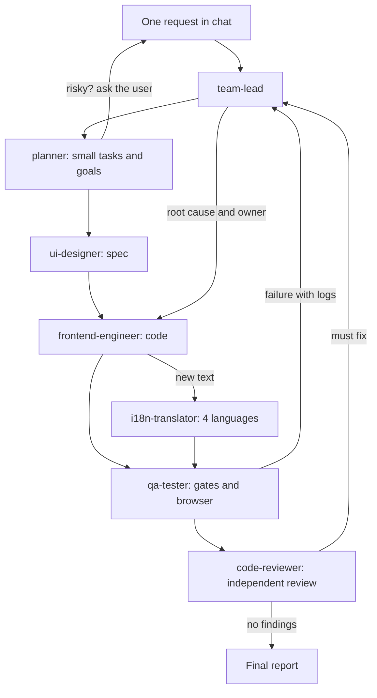

# Frosty Delights: demo script and project guide

How to use this guide: say the words in quotes; everything else is a note for you.

**Before you start**

1. Run `npm run build`, then `npm run start -- -p 3100`, and open http://localhost:3100 in a fresh browser tab.
2. Run your `/team` example once beforehand so you know how it behaves.
3. In VS Code settings, allow the team's safe commands (type check, lint, tests, build, start) so you are not interrupted by approval prompts. See "Approval prompts" in section 4.

**Contents:** 1 The idea, 2 What exists, 3 Live demo, 4 How the agent team works, 5 Questions you may get, 6 What is missing for production, 7 Resume lines.

## 1. The idea (30 seconds)

"Frosty Delights is a premium ice cream shop website with a full ordering journey: flavors, build-your-own, cart and checkout, live order tracking, rewards, subscriptions, five languages, dark mode and smooth motion. The project has two halves. The first is the product itself, built with Next.js and TypeScript. The second is how it is built: every change goes through a team of seven AI agents inside VS Code. I give one request, and the team plans it, designs it, writes it, translates it, tests it in a real browser, reviews it and fixes its own mistakes. I wanted to show both a polished product and a repeatable, safe way to build and change software with AI."

In one line: **a real-looking shop, built and maintained by an autonomous AI team that has to prove its work.**

## 2. What exists today (facts you can state)

- Next.js 16 App Router, React 19, TypeScript strict, Tailwind, zod, react-hook-form, Jest and Testing Library.
- 13 pages (home, flavors, build, menu, cakes-sundaes, checkout, orders, rewards, plans, subscription, locations, contact, about).
- 124 passing tests in 19 suites. Type check, lint and production build pass.
- Five languages (English, Spanish, Hindi, French, German), and a test that fails if any language is missing a key, a placeholder or a plural form.
- Light and dark mode, responsive from 375px to desktop, prices in rupees.
- Motion: pages fade in, sections slide up as you scroll, illustrations float, cards lift on hover. It switches off for people who turn on "reduce motion" in their system.
- Personalized picks, favorites, promo codes, a "buy 2, get 1 free" deal, rewards tiers, a subscription you can skip, pause, resume, cancel or switch.
- A cart drawer whose "Clear cart" button asks for confirmation first (built by the agent team; see section 3B).
- Seven development agents (a team lead and six specialists), a shared protocol, `CLAUDE.md`, `MEMORY.md` and two skills in the project.

Be upfront about this: all data is demo data stored in the browser or in `src/data`. There is no backend, no real payments and no real accounts.

## 3. Live demo flow (about 8 minutes)

### A. The product (3 minutes)

1. **Home.** "Hero, popular flavors, and a row called Picked for you. It starts with popular flavors and becomes personal once I favorite something or order." Scroll slowly: "Sections fade up as they come into view and the ice cream illustrations float. This was also built by the agent team."
2. **Flavors.** Search "mango", filter dairy-free, open Details (allergens and calories), favorite one, add to cart. "Every third scoop is free, and the cart shows the saving."
3. **Build Your Own.** Pick a waffle cone, two scoops, a topping. "The preview updates live and the price is calculated in code, not typed in."
4. **Cart and promo.** Apply `FROSTY10`. Then try `SWEET100` with a small cart: "It tells me how much more I need to spend." Click **Clear cart**: "It asks first, so a mis-tap cannot wipe the cart."
5. **Checkout.** Place an order for pickup. Open **My orders**: "The order moves through stages in real time. This is a demo timeline of seconds, not minutes."
6. **Rewards and subscription.** "Points come from orders. I can redeem a code. A subscription lets me skip, pause, switch plan or cancel, and every action updates the next delivery date."
7. **Language and theme.** Switch to Hindi, then dark mode. "The whole site is translated, including dates and currency format."

### B. The agent team (4 minutes)

Open the `frosty-delights` folder in VS Code and show these files in the explorer:

- `CLAUDE.md`: "The project's rules and the team roster. It tells the AI how to behave, what to ask before doing, and what 'done' means."
- `MEMORY.md`: "Lessons learned so the same mistake isn't repeated. For example, a real browser test caught a bug that unit tests missed, and that is now a rule."
- `.claude/agents/`: "Seven agents, one file each: a team lead and six specialists. Each has a name, a description of when to use it, the tools it is allowed to use, and its instructions."
- `.claude/skills/team/SKILL.md` and `protocol.md`: "The team lead's playbook: which agents run for which kind of request, how tasks are tracked, how work is handed over, and how failures loop back a limited number of times."
- `.claude/skills/project-conventions/SKILL.md`: "The technical rulebook: stack, folders, language rules, lint pitfalls and commands."

Then select the **team-lead** agent in the chat (or type `/team`) and give one request. A safe example, which the team has already built once:

```
/team add a "Clear cart" button to the cart drawer, with a confirmation, in all languages
```

Narrate while it runs. "I type one sentence and I do not tell the team what to do next."

1. "The **team-lead** restates the requirement, reads the code and writes a task list with a checkable goal for each task. That list is its ledger."
2. "The **planner** breaks the work into small tasks. It records its assumptions and only asks me about risky things, like new packages, deleting files, security changes or committing."
3. "The **ui-designer** specifies the button, the confirmation, the empty state, phone and dark-mode behavior."
4. "The **frontend-engineer** writes the code with the smallest possible change, and reports which new text it added."
5. "Because there is new text, the team lead automatically calls the **i18n-translator**. It adds the four other languages and runs the translation check. I did not ask for that."
6. "The **qa-tester** writes tests, runs type check, lint, tests and build, then opens the app in a browser at phone, tablet and desktop widths, in dark mode and in another language."
7. "If anything fails, the team lead finds the cause, sends it with the exact error to the agent that owns it, and re-tests. It gives up only after a set number of tries, and then it tells me exactly what is blocking it."
8. "The **code-reviewer** inspects the finished change on its own, without trusting the others. Anything it marks must-fix goes back for correction."
9. Show the final report: "The requirement, who did what, files changed, every fix and retry, the real test results, and what was not verified."

Point to the controls: "Agents that only read can run at the same time. Agents that edit files run one at a time so they never overwrite each other. Nothing is committed or installed without my approval."

### C. Engineering quality (1 minute)

Run `npm run typecheck`, `npm run lint` and `npx jest`. "124 tests. The language test fails if I add English text and forget another language."

## 4. How the agent team works

### The roster

| Agent | Job | Can edit | Hands over |
| --- | --- | --- | --- |
| **team-lead** | Runs the whole job: plans, delegates, checks reports, orders corrections, writes the final report | Only its task ledger and `MEMORY.md` | Briefs to every agent |
| **planner** | Turns the request into small tasks with acceptance criteria, flags risks and approvals | Nothing (read-only) | Task table, assumptions, approvals needed |
| **ui-designer** | Specifies layout, every state, phone/tablet/desktop and dark mode, accessibility | Nothing (read-only) | Design spec and new text keys |
| **frontend-engineer** | Implements the change in the app's code | App code | Changed files and new text keys |
| **i18n-translator** | Keeps English, Spanish, Hindi, French and German in sync | Only the language files | Keys added per language |
| **qa-tester** | Writes tests, runs the four quality gates, checks the real flow in a browser | Only test files | Gate results and reproducible failures with a suspected owner |
| **code-reviewer** | Independent review for bugs, accessibility, security and scope | Nothing (read-only) | Must fix / should fix / nice to have findings |

### How one job flows

1. **One request in.** "The user states what they want once."
2. **Plan.** The team lead and planner split it into small tasks, each with a checkable goal.
3. **Delegate.** Each agent gets a full brief: the original request, the task, the files, the goal and what the previous agent found. Agents do not remember each other, so nothing is assumed.
4. **Hand-offs.** Designer to engineer (the spec), engineer to translator (new text keys), engineer and translator to tester (changed files), tester to reviewer (gate results).
5. **Proactive triggers.** Agents cannot call each other, so each lists the follow-up work it needs in its report and the team lead acts on every item automatically: new text triggers the translator, changed code triggers the full tests, a failure triggers a fix.
6. **Correct until done.** For every failure the team lead names the root cause, picks the owner, sends the exact error, and has the tester re-run, then the reviewer re-checks. Bounded by limits so it cannot loop forever.
7. **Report.** The final report lists what was run and what passed, and never claims a check that was not run.



### Task tracking and recovery

The team lead keeps a plain task table in `.claude/ledger.md` (not committed): task ID, owner, status, dependencies, files, goal, test results, retries and blockers. A task is only "done" when an agent actually ran the check. If a session is interrupted, saying "continue" resumes from the table.

### The correction limits

| Limit | Default |
| --- | --- |
| Attempts per task | 3 |
| Correction rounds per job | 6 |
| Same failure repeated | Change approach the second time; stop the third time |
| No progress | Stop after two rounds |

You can override them in a request, for example "max rounds 3". When a limit is reached, the team reports the exact blocker instead of claiming success.

### Safety rules

- **Asks first** before: installing or removing packages, deleting files, changing secrets or environment settings, changing login or security, backend changes, major redesigns, committing or pushing.
- **Never** weakens or deletes a test to get green, and never changes app code just to make a test pass.
- **Proves** work with the real commands: `npm run typecheck`, `npm run lint`, `npx jest`, `npm run build`, plus a browser check for anything visual.
- All data in the project is mock and labelled.

### Approval prompts

VS Code asks before running terminal commands. That is a safety feature. To avoid constant prompts, allow only the team's safe commands in settings (`chat.tools.terminal.autoApprove`: type check, lint, tests, build, start, `git status`, `git diff`) and keep prompts for everything else. Do not turn on "approve everything".

### The pieces

| Piece | What it is | Why it matters |
| --- | --- | --- |
| `CLAUDE.md` | Standing instructions the AI reads first | Keeps behavior consistent and safe |
| `MEMORY.md` | Short list of lessons from past work | The team improves instead of repeating mistakes |
| Agent files | Role, allowed tools, instructions | Specialization: each agent does one job well |
| `team` skill and `protocol.md` | The team lead's workflow, task ledger and correction limits | Picks the right agents, tracks tasks and loops failures back a limited number of times |
| `project-conventions` skill | App-specific technical rules | Agents write code that matches the app |

Reuse: "Every new app I build gets the same team copied in from a template, so the workflow travels with the project."

## 5. Questions you may get

- **"Is this a real multi-agent system?"** "It is a multi-agent development workflow: specialized agents with roles, tools, structured hand-offs, a task ledger and a bounded correction loop, run by VS Code's AI. It is not a production service for end users. The next step, below, is to build one."
- **"Is any of the shop real?"** "No. Data is demo data, payments and accounts are simulated, and the assistant I prototyped earlier used keyword rules, not an AI model, and was removed from the app."
- **"How do you trust AI-written code?"** "Tests, type checking, lint, a build, a browser check at three screen sizes and a separate reviewer agent that does not grade its own work, plus approval for risky actions."
- **"Why separate agents instead of one prompt?"** "Smaller focused instructions are easier to improve, can run in parallel when they only read, and the reviewer isn't grading its own work."
- **"What if the agents get stuck or keep failing?"** "Every failure gets a root cause and an owner. Attempts are limited (3 per task, 6 rounds per job). If the same failure repeats or nothing improves, the team stops and reports the exact blocker instead of claiming success."
- **"Does it ask me for everything?"** "No. It makes reasonable choices from the project's rules and lists them in the report. It asks only for risky actions like installing packages, deleting files, security changes, committing or pushing."
- **"What are the limits today?"** "Agents cannot start other agents, so the team lead does all the coordination. Translations are machine-written and not checked by native speakers. Nothing runs in CI yet; the checks run on my machine."

## 6. What is missing for real-world, production use

### The shop itself

| Gap | Use |
| --- | --- |
| Real data and accounts | PostgreSQL with Prisma or Drizzle; Auth.js or Clerk for login |
| Real payments | Stripe Checkout and webhooks |
| Real order flow | Server-side order and inventory logic; a kitchen dashboard |
| Notifications | Resend or SendGrid for email; Twilio for SMS |
| Delivery and maps | Google Maps or Mapbox for addresses and tracking |
| Content | A headless CMS (Sanity or Contentful) for flavors and menu |
| Quality | Playwright end-to-end tests, Lighthouse and axe accessibility audits |
| Operations | Vercel hosting with preview deploys, GitHub Actions CI, Sentry for errors, analytics, feature flags |
| Security and privacy | OWASP review, rate limiting, input validation on the server, cookie and privacy policy |

### Shopper-facing multi-agent assistant (the real showcase)

| Gap | Use |
| --- | --- |
| A real model | Claude or OpenAI via their APIs, key kept on the server |
| Agent framework | LangGraph, the Vercel AI SDK or the Claude Agent SDK for supervisor and specialist agents |
| Real tools | Typed tool calls to the real order, subscription, rewards and store APIs; MCP servers to expose them |
| Knowledge | Retrieval from the catalog and FAQs with pgvector or Pinecone |
| Memory | Per-user preferences and conversation history in the database |
| Safety | Human confirmation for changes, prompt-injection defenses, output validation with zod, per-user rate limits and cost caps |
| Evals | A test set of questions with expected routing and answers, run in CI (Promptfoo or LangSmith evals) |
| Observability | Tracing of every agent step and tool call (Langfuse, LangSmith or OpenTelemetry), with latency and cost dashboards |
| Streaming UX | Token streaming, typing states, graceful fallbacks when the model is down |

### The development agent team

| Gap | Use |
| --- | --- |
| Automation | Run the same gates in GitHub Actions on every pull request |
| Real browser checks | Playwright MCP so the tester agent drives the browser itself |
| Repository access | GitHub MCP so agents open pull requests and read issues, with approval before merging |
| Review | A review agent that comments on pull requests |
| Measurement | Track how often agents' output passes the gates first time |

### Suggested order of work

1. Backend, accounts and payments, so the shop is real.
2. Playwright tests and CI, so every change is checked automatically.
3. The shopper-facing assistant with a real model, real tools, human confirmation and evals.
4. Tracing, cost limits and security hardening.
5. Deploy with preview environments, monitoring and analytics.

## 7. Resume and portfolio lines

- "Built Frosty Delights, a responsive e-commerce front end in Next.js 16 and TypeScript with cart, checkout, order tracking, rewards, subscriptions, five-language i18n, dark mode, accessible scroll animations and 124 automated tests."
- "Designed an autonomous multi-agent development workflow (team lead, planner, designer, engineer, translator, tester, reviewer) with structured hand-offs, a task ledger, a bounded self-correction loop, approval gates and automated quality checks."
- Do not claim LLM-powered shopper agents until you build the version in section 6.
